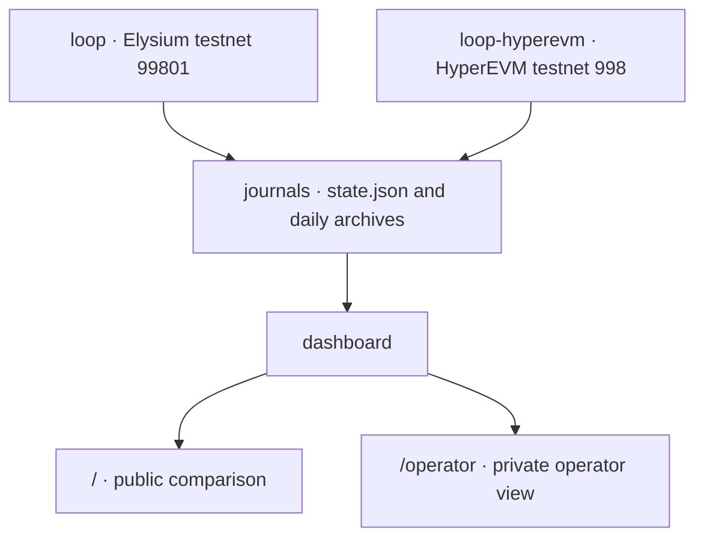

# elysium-latency-benchmark

Live testnet benchmark of inclusion latency and gas fees: Elysium vs HyperEVM.

Part of [ElysiumForge Labs](https://github.com/ElysiumForge-Labs).

> **Independent project.** Not affiliated with, endorsed by, or sponsored by Kinetiq or Hyperliquid. All figures are testnet measurements. They do not describe mainnet performance or prices.

A live benchmark of one question: is Elysium, a Layer 2 on Hyperliquid, faster and cheaper than HyperEVM, the Layer 1 it settles to, for the same transaction?

The same contract is deployed on both chains. One host submits the same load to both, with the same code, fee strategy, and polling. A read-only page compares inclusion latency and gas fees, and every figure links to a transaction on that chain's explorer.

## Measurements

| Metric | Meaning |
| --- | --- |
| Chain-side inclusion | Block timestamp minus the moment the client started submitting. This is the headline figure. Block timestamps are whole seconds, so a single sample is accurate to about 1 second. |
| Clock correction | Offset between the host clock and three public NTP servers, measured every 5 minutes and remeasured after a clock step. Each sample uses the offset from send time. Samples without a fresh offset are omitted. |
| RPC accept | Round trip of `eth_sendRawTransaction` to the chain's public RPC. |
| Observed inclusion | When the client saw the including block, polling every 500 ms. This includes RPC delay and poll delay. |
| Fee per transaction | `gasUsed × effectiveGasPrice` from the receipt, in HYPE on both chains. |
| Execution gas and posting gas | Elysium receipts report `gasUsedForL1`, the gas charged for posting data to the parent chain. Execution gas is the remainder. It matches HyperEVM because the bytecode is identical. |

Comparisons use the window in which both chains were running. Recovered and rebroadcast transactions are left out of percentiles. The latency difference carries a 95% bootstrap interval: 10,000 resamples, fixed seed. No result is shown until each chain has 200 samples. Results stay provisional until that shared window covers 24 hours.

Three limits apply to every reading:

- HyperEVM, on HyperBFT, is final when the block is produced. Elysium inclusion is a sequencer confirmation.
- Elysium produces a block when a transaction arrives.
- Testnet gas prices are chain parameters.

The page's Methodology section states the same limits next to the data.

## Architecture



`benchmark-10` submits 10 `pulse()` transactions per UTC minute on each chain. The default profile, `serial-1`, submits one.

| Path | Role |
| --- | --- |
| `src/config.mjs` | Pinned chain id, RPC URL, and anchor block hash for each chain. |
| `src/chain/` | Wallet, RPC clients, and compilation of `contracts/MinutePulse.sol`. |
| `src/journal/` | On-disk state, process lock, and the `HALT` switch. |
| `src/benchmark/` | Prepare, sign, broadcast, and time transactions. `engine.mjs` runs the 10-per-minute profile. `serial.mjs` deploys the contract and runs the one-per-minute profile. `loop.mjs` is the scheduler. |
| `src/snapshot/` | `compare.mjs` builds the public document. `publish.mjs` uploads it. `serve.mjs` is the read-only edge function. |
| `src/dashboard/` | Local read-only server and the operator payload. |
| `src/site/` | Copies `public/` into `web/` for static hosting. |
| `public/` | Comparison page. Charts are plain SVG. Asset paths are relative. |
| `scripts/` | Command entrypoints. Errors are redacted before they are printed. |

`engine.mjs` journals each signed transaction before broadcast, stays inside a per-chain RPC budget, watches new blocks every 500 ms, and settles cost from the receipt. `compare.mjs` is the only path from those journals to the public page. The document omits the account address, balances, spend, nonces, and operator holds. Tests enforce that allowlist.

`MinutePulse` is a counter. Only the deployer's address may call it.

## Safety

- **Pinned chains.** RPC URL, chain id, and anchor block hash live in `src/config.mjs`. The environment cannot change them. `--chain` selects one of the two pinned entries.
- **One journal per chain.** A journal records its chain id and is refused if opened for another chain.
- **Live gates.** A write requires `ELYSIUM_LIVE_ENABLED=true` and `--live`. Benchmark mode also requires `ELYSIUM_BENCHMARK_ENABLED=true`, `--profile benchmark-10`, and `compose.benchmark.yaml`.
- **Nonce authority.** The journal owns nonces. Each signed transaction is stored before broadcast. A nonce consumed by an unknown transaction stops the loop for operator review.
- **Cost limits.** Per-transaction gas, fee, and cost caps, a balance reserve, and a daily budget. Worst-case cost is reserved when a batch is prepared.
- **Stop switch.** A `HALT` file in the state directory stops writes immediately.
- **Wallet key.** Generated at `~/.config/elysium-minute-loop/wallet.json` with mode `0600`. It is not printed, logged, or committed. The dashboard and publisher containers do not mount it.

## Run

Requirements: Node.js 22 or newer. Docker Compose for the long-running processes.

Create a wallet. The command prints the address only.

```bash
npm ci
npm test
npm run generate:wallet
```

Fund that address with testnet HYPE on both chains.

- **HyperEVM testnet.** Obtain HYPE on Hyperliquid testnet (HyperCore), then transfer it to HyperEVM. The testnet UI can send it to the HYPE system address `0x2222222222222222222222222222222222222222`.
- **Elysium testnet.** Bridge HYPE with the official Elysium testnet bridge.

Confirm both RPCs, then deploy once per chain.

```bash
npm run verify:rpc
npm run verify:rpc -- --chain hyperevm-testnet
ELYSIUM_LIVE_ENABLED=true npm run deploy
ELYSIUM_LIVE_ENABLED=true npm run deploy -- --chain hyperevm-testnet
```

Start both benchmark loops and the dashboard.

```bash
cp .env.example .env
install -d -m 700 ~/.local/state/elysium-minute-loop ~/.local/state/elysium-minute-loop-hyperevm
docker compose build loop
docker compose -f compose.yaml -f compose.benchmark.yaml --profile benchmark up -d
```

Set `DASHBOARD_BIND_IP` in `.env` to the private address the dashboard should bind to. The comparison page is at `http://<DASHBOARD_BIND_IP>:8789/`.

`docker compose up` without the benchmark overlay runs only `serial-1` on Elysium: one transaction per minute.

`/operator` shows the benchmark account, balance, and holds. It is read-only and unauthenticated, so keep it on a private network. Profiles, budgets, holds, journal rotation, and the Tailscale ACL are in [docs/operator-profiles.md](docs/operator-profiles.md).

## Public site

`web/` is the Vercel project. Root directory `web`, no framework, and no build or install command. `npm run build:web` regenerates it from `public/`, points the page at `/snapshot.json`, copies `src/snapshot/serve.mjs` to `web/api/snapshot.mjs`, and writes a Content-Security-Policy that allows connections only to the page origin.

The page reads `/snapshot.json`. That route is a read of one gzipped value in Upstash KV, cached at the CDN for 60 seconds. Vercel holds only `KV_REST_API_READ_ONLY_TOKEN`. The benchmark host is not reachable from the deployment.

The publisher container writes that value every 5 minutes and skips the write when only `generatedAt` changed. A 5-minute interval stays under 9,000 commands against the free plan's 500,000 monthly commands. Its secrets are `KV_REST_API_URL` and `KV_REST_API_TOKEN`, read from an env file outside the repo. It mounts the journals read-only and publishes no ports.

Without KV credentials it falls back to Vercel Blob, one upload every 30 minutes. Each upload counts as an advanced operation. The Hobby plan includes 2,000 a month and suspends the store past that limit.

```bash
install -d -m 700 ~/.config/elysium-vs-hyperevm-publisher
install -m 600 /dev/null ~/.config/elysium-vs-hyperevm-publisher/blob.env
docker compose -f compose.yaml -f compose.benchmark.yaml -f compose.publish.yaml --profile benchmark up -d publisher
```

Put `KV_REST_API_URL` and `KV_REST_API_TOKEN` in `blob.env` before starting the publisher.

## Development

```bash
npm test
npm run lint
npm run format:check
```

`npm test` uses `node:test` and does not touch the network. CI runs the three commands on Node.js 22 and 24, then `npm audit`.

## License

MIT.

---

Unofficial community project. Not affiliated with Kinetiq/Hyperliquid.
